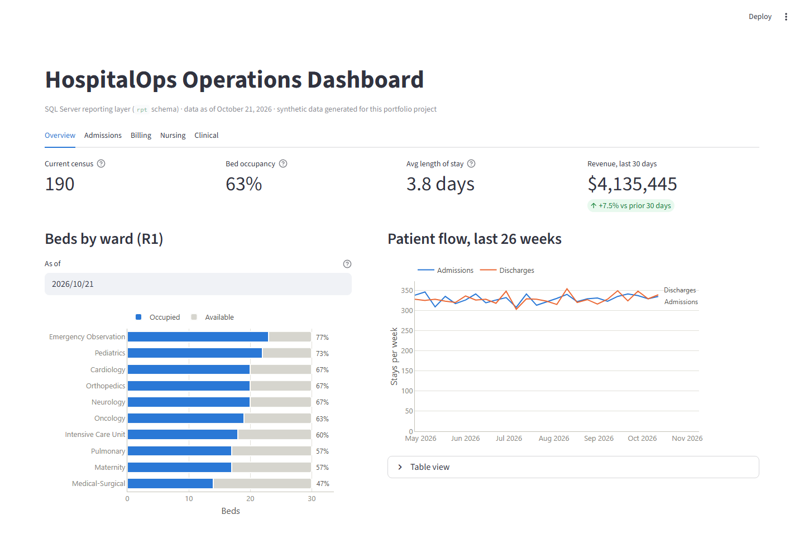
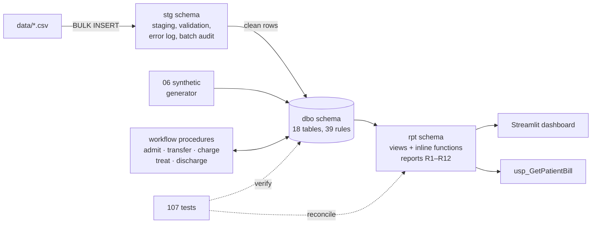
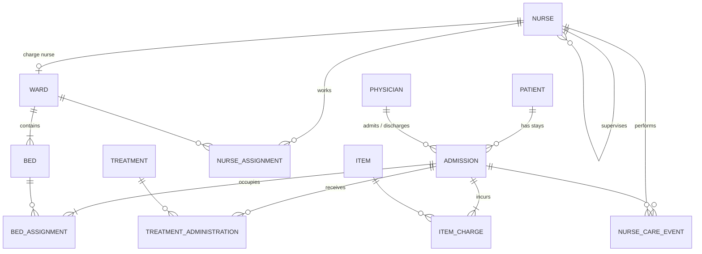
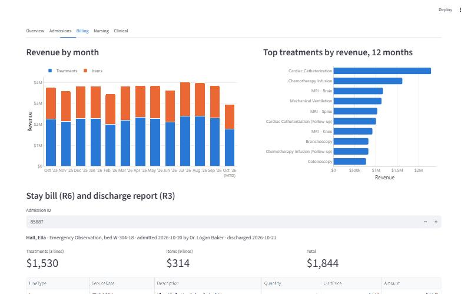
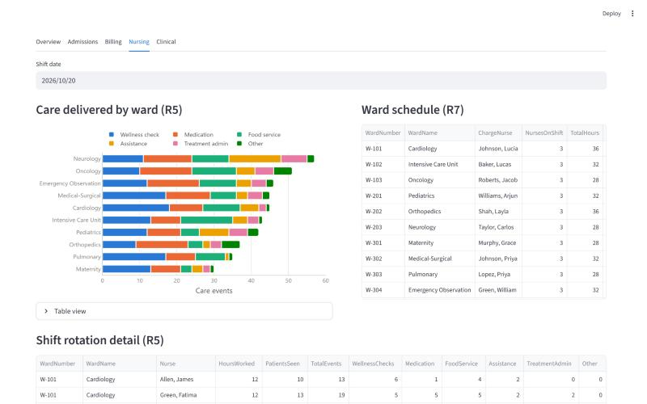

# Hospital Operations Database

A complete SQL Server project for running a hospital's wards: nurses, beds, admissions, treatments, billing and nursing care. It goes from **requirements and a normalized design** to **ETL, transactional procedures, a reporting layer, measured performance tuning and a dashboard**, and 107 automated tests back every claim.

> Built on my coursework for **ISM 6218 Advanced Database Management** (University of South Florida, Fall 2024, Database Team 5), then audited, redesigned and extended as an individual portfolio project.



## At a glance

| | |
|---|---|
| **Design** | 18 tables in 3NF · 39 business rules, each traced to the constraint or procedure that enforces it · 16 defects found and fixed in the original course build |
| **Data** | ~1.39M rows: 5 years of consistent synthetic history plus an audited CSV ETL (11 validation rules, error table, idempotent reloads) |
| **Logic** | 6 transactional workflow procedures (admit, transfer, charge, treat, discharge, bill) · 17 reporting views and functions covering all 12 required reports |
| **Performance** | 10 benchmarked indexes: **7× to 2,498× fewer reads**, worst report **2.6 s → 6 ms** · parameter sniffing, `RECOMPILE`, Query Store |
| **Quality** | **107 automated tests** (constraints, data quality, ETL, workflow, report reconciliation). They caught 3 real bugs during development. |
| **Dashboard** | Streamlit + Plotly, 5 tabs, color-blind-safe palette validated in light and dark |

## Quick start

**Windows + SQL Server** (2019+ Developer or Express, Windows authentication):

```powershell
.\setup.ps1 -Launch
```

This checks prerequisites, builds the database (~1.4M rows), runs all 107 tests, sets up and smoke-tests the dashboard, then opens it at http://localhost:8501. The first run takes about 6 minutes (mostly installing Python packages); later runs take about 2.

**Any OS with Docker:**

```bash
docker compose up
```

This starts SQL Server 2022 in a container, builds the database and runs all 107 tests. The `build` container exits with code 0 only if everything passed. To point the dashboard at the container, set `HOSPITALOPS_SERVER=localhost,14333`, `HOSPITALOPS_USER=sa` and `HOSPITALOPS_PASSWORD` (see [dashboard/README.md](dashboard/README.md)).

## What this project demonstrates

| Skill | Where to look |
|---|---|
| Requirements → ERD → relational schema → data dictionary | [docs/01–04](docs/), Mermaid ERDs in [03](docs/03_erd_and_schema.md) |
| Auditing an existing database from the system catalog | [05 Design review](docs/05_design_review.md): a no-op foreign key, a primary key that blocked nurse rotations, and 14 more |
| Declarative integrity: keys, CHECK, DEFAULT, computed columns, **filtered unique indexes** | [`sql/03_constraints.sql`](sql/03_constraints.sql), e.g. no double-booked beds via `UNIQUE (BedID) WHERE EndDate IS NULL` |
| ETL with staging, validation, error capture and audit | [`sql/05_etl_patient_import.sql`](sql/05_etl_patient_import.sql) |
| Set-based data generation (no loops) | [`sql/06_generate_bulk_data.sql`](sql/06_generate_bulk_data.sql) |
| Joins (self, outer, apply), CTEs (incl. recursive), window functions, `PIVOT`, `EXCEPT`/`INTERSECT`, gaps and islands | [`sql/07_reporting_views.sql`](sql/07_reporting_views.sql), [`queries/business_queries.sql`](queries/business_queries.sql) |
| Stored procedures, transactions, savepoints, lock hints for concurrency | [`sql/08_stored_procedures.sql`](sql/08_stored_procedures.sql), [06 Reports and procedures](docs/06_reports_and_procedures.md) |
| Execution plans, covering and filtered indexes, index hints, `RECOMPILE`, Query Store | [PERFORMANCE.md](performance/PERFORMANCE.md) |
| Testing a database: named-constraint tests, data-quality checks, report reconciliation | [`tests/`](tests/) |
| Serving the reporting layer to users | [`dashboard/`](dashboard/README.md) |

## Highlights

**Every rule lives in the database.** "A bed can't hold two patients" isn't application code. It's a filtered unique index, and the procedures check-then-act under `UPDLOCK, HOLDLOCK` so two simultaneous admissions can't race for the same bed. Rules that SQL Server can't declare, such as "every stay has at least one charge", are enforced in procedures and verified by data-quality checks.

**Performance work that's measured, not guessed.** A 15-query benchmark records logical reads, CPU and execution plans before and after tuning. All four hot spots had an *Eager Index Spool*: SQL Server was rebuilding a temporary index in tempdb on every run. The write-up also records the costs (+51 MB storage, 3.6× bulk-insert I/O), a filtered-index gotcha, and the indexes I deliberately didn't add. → [PERFORMANCE.md](performance/PERFORMANCE.md)

**Tests that found real bugs.** A data-quality check caught synthetic events dated in the future. A rebuild caught a procedure that rejected its own default timestamp about half the time, because `DATETIME2(0)` rounds up; it now has a regression test. A plan review caught a filtered index the optimizer silently ignored.

**Honest data.** The CSV ETL loads the course's real 100-row extract plus a crafted batch with one defect per validation rule: 11 rows rejected with the exact source line and reason. The synthetic history is consistent by construction (no overlapping stays, every care event by a nurse on shift in that ward). Its known limitation is documented: distributions are uniform, so some analytics come out flat.

## Architecture



## Data model



Full logical model with every attribute: [03 ERD and schema](docs/03_erd_and_schema.md).

| Billing tab | Nursing tab |
|---|---|
|  |  |

## Documentation

| Doc | Contents |
|---|---|
| [01 Requirements](docs/01_requirements.md) | Problem, scope, actors, admit workflow, the 12 required reports |
| [02 Business rules](docs/02_business_rules.md) | 39 rules, each with its enforcement mechanism |
| [03 ERD and schema](docs/03_erd_and_schema.md) | Conceptual and logical ERD, relational schema, normalization |
| [04 Data dictionary](docs/04_data_dictionary.md) | Every table, column, constraint, ETL error code and row count |
| [05 Design review](docs/05_design_review.md) | Audit of the original course build: 16 defects → fixes and trade-offs |
| [06 Reports and procedures](docs/06_reports_and_procedures.md) | Report catalog, procedures, transaction design, error catalog, analytics |
| [Performance tuning](performance/PERFORMANCE.md) | Method, before/after results, plan diagnosis, trade-offs, sniffing demo |
| [Dashboard](dashboard/README.md) | Tabs, how to run, driver and design choices |

<details>
<summary><b>Repository layout and build scripts</b></summary>

```
setup.ps1            one-command setup on Windows
docker-compose.yml   one-command build on any OS (docker/build.sh)
run_sql.ps1          build/test runner (splits on GO, no sqlcmd or ODBC needed)
sql/                 numbered, re-runnable build scripts
tests/               automated tests
queries/             analytical business queries (not part of the build)
performance/         benchmark harness, results, before/after .sqlplan files, sniffing demo
dashboard/           Streamlit app over the rpt schema
data/                ETL source files (course extract + crafted test batch)
docs/                design documentation (original v1 diagrams in docs/original/)
```

| Script | What it does |
|---|---|
| `sql/01_create_database.sql` | Database, `stg` / `rpt` schemas, read-committed snapshot, Query Store |
| `sql/02_create_tables.sql` | 18 tables with primary keys and computed columns |
| `sql/03_constraints.sql` | 22 FKs, 21 checks, 7 defaults, 10 unique constraints, 3 filtered unique indexes, each tagged with its rule |
| `sql/04_reference_data.sql` | Idempotent `MERGE` of lookup data |
| `sql/05_etl_patient_import.sql` | Patient ETL with validation, error table and batch audit |
| `sql/06_generate_bulk_data.sql` | ~1.39M rows of reproducible synthetic data |
| `sql/07_reporting_views.sql` | `rpt` views and inline functions for R1–R12 and the dashboard |
| `sql/08_stored_procedures.sql` | Workflow procedures and the itemized bill |
| `sql/09_performance_indexes.sql` | 10 tuning indexes, each tied to a measured query |
| `tests/test_constraints.sql` | 41 tests: each invalid case rejected *by the expected named constraint* |
| `tests/test_data_quality.sql` | 15 cross-table checks constraints can't express |
| `tests/test_etl.sql` | 9 tests: every crafted defect caught by the right rule; idempotent reload |
| `tests/test_procedures_and_reports.sql` | 42 tests: full stay walk-through, every error code, savepoints, all 12 reports reconciled |

Other entry points:

```powershell
.\run_sql.ps1 -Test                                   # rebuild + tests only
.\performance\run_benchmark.ps1                       # before/after index benchmark -> results.md + plans
.\run_sql.ps1 -Files performance\parameter_sniffing_demo.sql
.\run_sql.ps1 -Files queries\business_queries.sql
```
</details>

## Tech stack

SQL Server 2022 · T-SQL · PowerShell · Python (Streamlit, Plotly, pandas, mssql-python) · Docker · Mermaid

## Credits

The original v1 design and database were built by ISM 6218 Database Team 5: Arnav Dhairyasheel Mohite, Onisha Gangwal and Simran Anjana Rajput. The v2 audit, redesign, ETL, synthetic data, procedures, reporting layer, performance work, tests and dashboard are by Onisha Gangwal.
