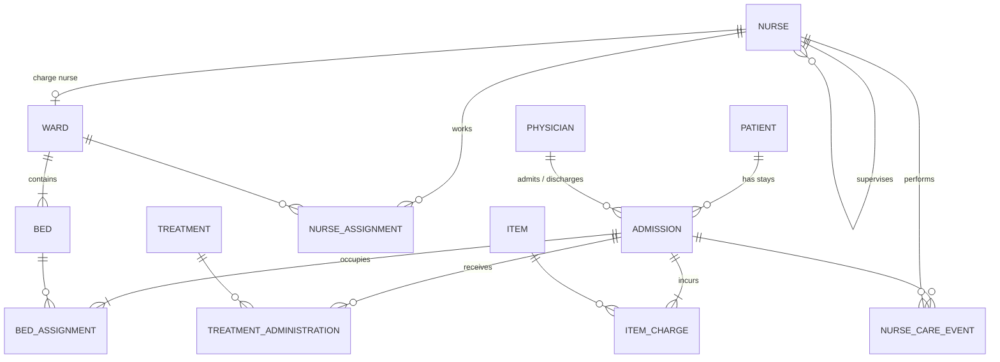

# Hospital Operations Database

A SQL Server database for hospital ward operations covering nurses, wards, beds, admissions, treatments, billing and nurse care events. The project runs end to end: requirements, a normalized design, ETL, stored procedures, performance tuning, and a reporting dashboard.

> Built on coursework from **ISM 6218 Advanced Database Management** (USF, Fall 2024, Database Team 5), then audited, redesigned and extended as an individual portfolio project.

## Highlights
- **Integrity in the database:** 39 business rules, each traced to a constraint, filtered unique index or stored procedure. For example, a bed cannot be double-booked, enforced by a filtered unique index on `BedID WHERE EndDate IS NULL`.
- **Audited ETL:** CSV → staging → validation → load, with 11 validation rules, a per-row error table that records the source line, a batch audit log and idempotent reloads.
- **1.39M rows of consistent synthetic data**, generated set-based and reproducibly in ~80 s. Five years of hospital history in which beds are never double-booked and every care event is performed by a nurse who was on shift in that ward that day.
- **All 12 required reports** as `rpt` views and inline functions, each reconciled against the base tables by automated tests.
- **Transactional workflow procedures** (admit, transfer, charge, treat, discharge) using the savepoint pattern, so they compose inside larger transactions. Lock hints (`UPDLOCK, HOLDLOCK` / `READPAST`) close the check-then-act race on beds. Errors use a documented 500xx catalog.
- **107 automated tests:** 41 constraint, 15 data-quality, 9 ETL, 26 workflow and 16 report reconciliations. They caught real bugs during development: events generated in the future, and a timestamp-rounding bug in a procedure.
- **Design review:** I audited the original course build from the system catalog and found 16 defects, including a no-op foreign key and a primary key that blocked nurse rotations. All are fixed in v2. See [design review](docs/05_design_review.md).
- **Measured performance tuning:** 10 indexes, each justified by a benchmarked query, cut logical reads **7× to 2,498×** (worst report 2.6 s → 6 ms). The diagnosis came from execution plans (eager index spools). The write cost is measured too (3.6× on bulk inserts). A parameter sniffing demo covers `RECOMPILE`, index hints and Query Store. See [PERFORMANCE.md](performance/PERFORMANCE.md).

## Data model



The full logical model with attributes is in [docs/03_erd_and_schema.md](docs/03_erd_and_schema.md).

## Documentation
| Doc | Contents |
|---|---|
| [01 Requirements](docs/01_requirements.md) | Problem, scope, actors, admit workflow, the 12 required reports |
| [02 Business rules](docs/02_business_rules.md) | 39 rules, each with its enforcement mechanism |
| [03 ERD and schema](docs/03_erd_and_schema.md) | Conceptual and logical ERD, relational schema, normalization |
| [04 Data dictionary](docs/04_data_dictionary.md) | Every table, column, type and constraint |
| [05 Design review](docs/05_design_review.md) | v1 audit findings → v2 fixes and trade-offs |
| [06 Reports and procedures](docs/06_reports_and_procedures.md) | Report catalog, workflow procedures, transaction design, error catalog, analytical queries, sample output |
| [Performance tuning](performance/PERFORMANCE.md) | Method, before/after results, plan diagnosis, trade-offs, parameter sniffing and Query Store |

## Quick start
Requires SQL Server 2019+ (Developer or Express) on Windows with Windows authentication.

```powershell
.\run_sql.ps1 -Test                     # build the HospitalOps database, then run the test suite
.\run_sql.ps1 -Server ".\SQLEXPRESS"    # target a named instance
```

`run_sql.ps1` runs the numbered scripts in `sql/` in order, splitting on `GO` like SSMS does. It uses the .NET SqlClient built into Windows, so it needs no sqlcmd or ODBC driver. You can also open the scripts in SSMS and run them in order.

| Script | What it does |
|---|---|
| `sql/01_create_database.sql` | Database, `stg` / `rpt` schemas, read-committed snapshot, Query Store |
| `sql/02_create_tables.sql` | 18 tables with primary keys and computed columns (`Age`, persisted `LineTotal`) |
| `sql/03_constraints.sql` | 22 foreign keys, 21 checks, 7 defaults, 10 unique constraints, 3 filtered unique indexes, each tagged with its business rule |
| `sql/04_reference_data.sql` | Idempotent `MERGE` of care event types, specialties and certifications |
| `sql/05_etl_patient_import.sql` | Patient ETL: `BULK INSERT` into `stg`, cleaning view, validation into `stg.PatientImportError`, load into `dbo.Patient`, batch audit in `stg.LoadBatch` |
| `sql/06_generate_bulk_data.sql` | ~1.39M rows of reproducible synthetic data across all tables (5 years of history) |
| `sql/07_reporting_views.sql` | Reporting layer: views and inline TVFs for reports R1–R12 |
| `sql/08_stored_procedures.sql` | `usp_AdmitPatient`, `usp_TransferPatient`, `usp_RecordItemCharge`, `usp_RecordTreatment`, `usp_DischargePatient`, `usp_GetPatientBill` |
| `sql/09_performance_indexes.sql` | 10 tuning indexes, each tagged with the workload query it serves, plus the ones deliberately not added |
| `tests/test_constraints.sql` | **41 tests**: valid data is accepted and every invalid case is rejected *by the expected named constraint*. Runs in a rolled-back transaction. |
| `tests/test_data_quality.sql` | **15 checks** constraints can't express: minimum cardinalities, no overlapping stays, events inside their stay, nurse on shift, no supervision cycles (recursive CTE) |
| `tests/test_etl.sql` | **9 tests**: batch counts, every crafted defect caught by the right rule, normalization, idempotent reload |
| `tests/test_procedures_and_reports.sql` | **42 tests**: a full admit → charge → treat → transfer → discharge walk-through, every documented error, savepoint behavior, and reconciliation of all 12 reports |
| `queries/business_queries.sql` | 12 analytical questions (window functions, `PIVOT`, `EXCEPT`/`INTERSECT`, gaps and islands). Not part of the build: run with `-Files queries\business_queries.sql` |

A full build from scratch, including the data load and all 107 tests, takes about 90 seconds.

```powershell
.\performance\run_benchmark.ps1                          # before/after index benchmark -> performance/results.md + .sqlplan files
.\run_sql.ps1 -Files performance\parameter_sniffing_demo.sql
```

## ETL: patient import
```
data/*.csv ──BULK INSERT──▶ stg.PatientImport ──vw_PatientImportClean──▶ validate ──▶ dbo.Patient
                                   │                                         │
                             stg.LoadBatch (audit)                stg.PatientImportError
```
Two files are loaded:

- `patient_import.csv` is the course's 100-row extract. It is clean, so all 100 rows load.
- `patient_import_batch2.csv` is a **crafted** 15-row extract with one deliberate defect per rule: bad and future dates, invalid codes, short zip and phone, an over-long name, an in-file duplicate, a patient already loaded, and a quoted comma. 3 rows load, 11 are rejected with the exact source line and reason, and 1 is skipped as already present. It also uses Unix line endings, while the course file uses Windows, so both formats are exercised.

| Line | Code | Reason | Raw value |
|---|---|---|---|
| 5 | E02 | DOB is missing or not a valid date | `31/02/1990` |
| 9 | E06 | State is not a valid US state code | `XX` |
| 12 | S01 | Already exists as PatientID 1 | `Joelle Grant Oct 15, 1961` |
| 13 | E10 | Duplicate of line 2 in the same file | `Maria Lopez 1985-03-22` |

*(excerpt from `stg.PatientImportError`; the full rule list is in the [data dictionary](docs/04_data_dictionary.md#staging-stg-schema))*

## Synthetic data
`sql/06_generate_bulk_data.sql` simulates five years of operations so query tuning in Phase 5 runs at realistic volume:

| Metric | Value |
|---|---|
| Patients / stays | 50,000 / ~86,000 (~36,000 returning patients) |
| Treatments / item charges / care events | ~216,000 / ~430,000 / ~467,000 |
| Current bed occupancy | ~63% |
| Average length of stay | ~3.9 days |
| Average bill per stay | ~$2,470 |

How it stays consistent without loops: each bed's history is laid out as back-to-back stays, so stays on a bed can't overlap. Stays are dealt to patients round-robin, so a patient's stays are years apart. The care-event nurse is computed with the same rotation formula as the shift schedule. All randomness comes from a hash of the row number (`stg.fn_Rand`), so every build produces the same data. Prices drift about 4% a year, so the price-snapshot columns hold real history.

## Workflow example
```sql
DECLARE @stay INT, @bed INT;
EXEC dbo.usp_AdmitPatient     @PatientID = 42, @AdmitPhysicianID = 7, @WardID = 1,
                              @AdmissionID = @stay OUTPUT, @AssignedBedID = @bed OUTPUT;
EXEC dbo.usp_RecordItemCharge @AdmissionID = @stay, @ItemID = 3, @Quantity = 2;
EXEC dbo.usp_DischargePatient @AdmissionID = @stay, @DischargePhysicianID = 7;
EXEC dbo.usp_GetPatientBill   @AdmissionID = @stay;     -- itemized bill (report R6)

SELECT * FROM rpt.vw_BedOccupancyByWard ORDER BY WardNumber;          -- R1 today
SELECT * FROM rpt.fn_BedOccupancyOn('2025-01-15') ORDER BY WardNumber; -- R1 on any past date
```
See [06 Reports and procedures](docs/06_reports_and_procedures.md) for every report, procedure and error code.

## Tech stack
SQL Server 2022 · T-SQL · SSMS · Mermaid (diagrams) · Power BI *(planned)*

## Repository layout
```
docs/          design documentation (original v1 diagrams in docs/original/)
sql/           numbered, re-runnable build scripts
tests/         automated tests (constraints, data quality, ETL, procedures, reports)
queries/       analytical business queries
run_sql.ps1    build / test runner
data/          source CSVs for the ETL (course extract + crafted test batch)
performance/   benchmark harness, results, before/after execution plans, sniffing demo
dashboard/     reporting dashboard
```

## Roadmap
- [x] **Phase 1:** Requirements, business rules, ERD, data dictionary, design review
- [x] **Phase 2:** Schema DDL (tables, keys, checks, defaults, computed columns) + 41 automated constraint tests
- [x] **Phase 3:** ETL from CSV via staging with validation and audit; 1.39M rows of synthetic data; data-quality and ETL tests
- [x] **Phase 4:** Reporting views for R1–R12, transactional workflow procedures, 12 analytical queries, 41 workflow and report tests
- [x] **Phase 5:** Benchmarked index tuning (15-query workload, before/after plans), parameter sniffing / RECOMPILE / Query Store demo
- [ ] **Phase 6:** Reporting dashboard
- [ ] **Phase 7:** One-command setup (Docker) and final write-up

## Credits
The original v1 design and build was done by Database Team 5: Arnav Dhairyasheel Mohite, Onisha Gangwal and Simran Anjana Rajput. The v2 audit, redesign and extensions are by Onisha Gangwal.
