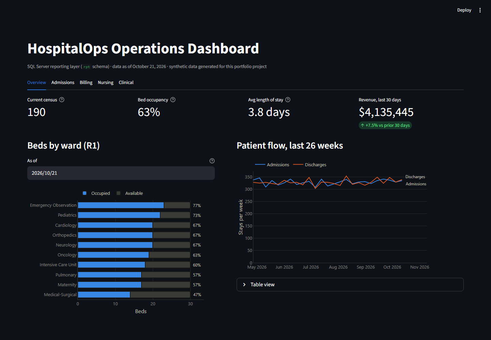

# HospitalOps Dashboard

A Streamlit dashboard covering all 12 required reports (R1–R12). It reads **only the `rpt` schema** (views, inline table-valued functions and `dbo.usp_GetPatientBill`), so it can never disagree with the SQL reports.


| Tab | Shows | Reports |
|---|---|---|
| Overview | Census, occupancy, length of stay and revenue KPIs; beds by ward for any date; weekly patient flow | R1 |
| Admissions | Admissions/discharges for a period; physician admits by month; a patient's ward history | R2, R4, R8 |
| Billing | Revenue by month; top treatments; itemized bill and discharge report for any stay | R3, R6 |
| Nursing | Care delivered by ward and type for a shift date; ward schedule with charge nurse; roster and supervision tree | R5, R7, R12 |
| Clinical | Treatments without a treating physician; physicians and specialties; a physician's treatment history | R9, R10, R11 |

## Run it

Prerequisite: the HospitalOps database is built (`.\run_sql.ps1` from the repo root).

```powershell
cd dashboard
python -m venv .venv
.venv\Scripts\pip install -r requirements.txt
.venv\Scripts\python smoke_test.py          # optional: checks every query (19 checks)
.venv\Scripts\streamlit run app.py          # opens http://localhost:8501
```

By default it connects to `localhost` with Windows authentication. Set `HOSPITALOPS_SERVER` for a named instance, for example `.\SQLEXPRESS`.

**Against the Docker database** (`docker compose up` from the repo root), use SQL authentication:

```bash
export HOSPITALOPS_SERVER="localhost,14333" HOSPITALOPS_USER=sa HOSPITALOPS_PASSWORD='HospitalOps!Dev2026'
# PowerShell: $env:HOSPITALOPS_SERVER="localhost,14333"; $env:HOSPITALOPS_USER="sa"; $env:HOSPITALOPS_PASSWORD='HospitalOps!Dev2026'
```

On macOS/Linux, create the venv with `python3 -m venv .venv` and use `.venv/bin/...` instead of `.venv\Scripts\...`.

**"No connection could be made because the target machine actively refused it"** means the database container isn't running. For example, `docker compose up --exit-code-from build` stops it once the build finishes. The data is kept inside the container, so start the database again (no rebuild) with:

```bash
docker compose up -d --wait db
```

## Design notes

- **Driver:** [`mssql-python`](https://pypi.org/project/mssql-python/), Microsoft's Python driver. It bundles its own ODBC layer, so nothing has to be installed system-wide. The legacy driver built into Windows can't complete the TLS handshake with SQL Server 2022.
- **Layers:** `db.py` holds data access (plain functions returning DataFrames, no Streamlit dependency, so `smoke_test.py` can call them directly). `charts.py` builds the figures. `app.py` does layout and caching (5-minute TTL).
- **Color:** a reference palette **validated** for color-vision-deficiency separation and contrast, with separate steps for light and dark mode. Categorical colors are assigned in a fixed order, so a care-event type keeps its color on every chart. Light slots 3–5 are below 3:1 contrast against white, so charts that use them always carry a legend plus a table view.
- **Marks:** 2px lines, rounded bar ends, 2px gaps between stacked segments, hairline gridlines, one y-axis per chart, hover tooltips on every mark, and direct labels only where they add information.
- **Theme:** chart colors are computed server-side, so they follow the *configured* Streamlit theme (pinned to light in `.streamlit/config.toml`; start with `--theme.base dark` for dark). An earlier version guessed the theme from the viewer's browser and produced dark chart colors on a light page.


