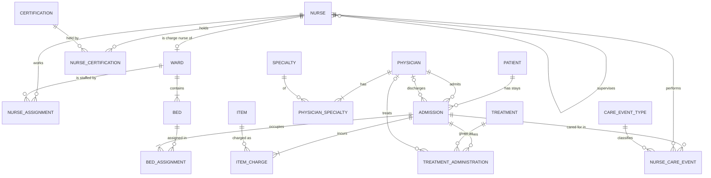
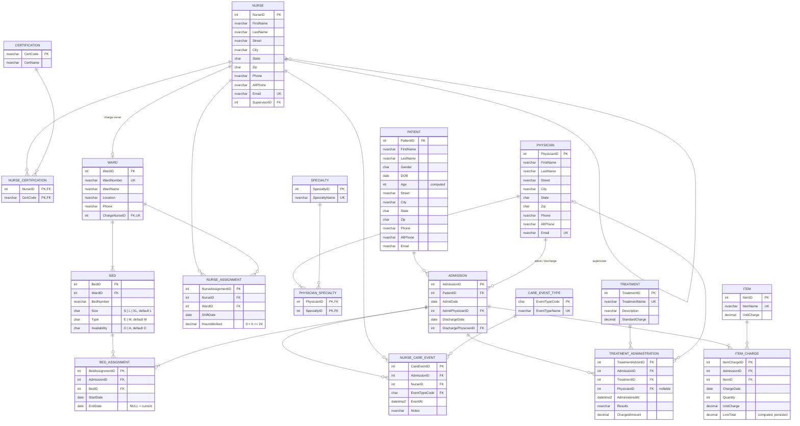

# 3. ERD and Relational Schema (v2)

The original v1 Chen-notation diagrams from the course are kept in [`original/`](original/) for comparison:
[ERD](original/v1_erd.png) · [EERD](original/v1_eerd.png) · [Relational schema](original/v1_relational_schema.png).
[05_design_review.md](05_design_review.md) explains what changed between v1 and v2.

## 3.1 Conceptual ERD

The design is centered on the **Admission** (one hospital stay). In v1, treatments, charges, bed and care events hung directly off `Patient`. Hanging them off the stay means a returning patient's bills and bed history stay separate per visit (report R6).

**Reading the crow's feet:** `||` exactly one · `|o` zero or one · `|{` one or many · `o{` zero or many.

## 3.2 Logical model with attributes

## 3.3 Relational schema (text notation)

Primary keys are <u>underlined</u>; foreign keys are *italic* and point to the referenced relation.

- **Certification** (<u>CertCode</u>, CertName)
- **Specialty** (<u>SpecialtyID</u>, SpecialtyName)
- **CareEventType** (<u>EventTypeCode</u>, EventTypeName)
- **Nurse** (<u>NurseID</u>, FirstName, LastName, Street, City, State, Zip, Phone, AltPhone, Email, *SupervisorID* → Nurse)
- **NurseCertification** (<u>*NurseID*</u> → Nurse, <u>*CertCode*</u> → Certification)
- **Physician** (<u>PhysicianID</u>, FirstName, LastName, Street, City, State, Zip, Phone, AltPhone, Email)
- **PhysicianSpecialty** (<u>*PhysicianID*</u> → Physician, <u>*SpecialtyID*</u> → Specialty)
- **Patient** (<u>PatientID</u>, FirstName, LastName, Gender, DOB, [Age], Street, City, State, Zip, Phone, AltPhone, Email)
- **Ward** (<u>WardID</u>, WardNumber, WardName, Location, Phone, *ChargeNurseID* → Nurse)
- **Bed** (<u>BedID</u>, *WardID* → Ward, BedNumber, Size, Type, Availability)
- **NurseAssignment** (<u>NurseAssignmentID</u>, *NurseID* → Nurse, *WardID* → Ward, ShiftDate, HoursWorked)
- **Admission** (<u>AdmissionID</u>, *PatientID* → Patient, AdmitDate, *AdmitPhysicianID* → Physician, DischargeDate, *DischargePhysicianID* → Physician)
- **BedAssignment** (<u>BedAssignmentID</u>, *AdmissionID* → Admission, *BedID* → Bed, StartDate, EndDate)
- **Treatment** (<u>TreatmentID</u>, TreatmentName, Description, StandardCharge)
- **TreatmentAdministration** (<u>TreatmentAdminID</u>, *AdmissionID* → Admission, *TreatmentID* → Treatment, *PhysicianID* → Physician, AdministeredAt, Results, ChargedAmount)
- **Item** (<u>ItemID</u>, ItemName, UnitCharge)
- **ItemCharge** (<u>ItemChargeID</u>, *AdmissionID* → Admission, *ItemID* → Item, ChargeDate, Quantity, UnitCharge, [LineTotal])
- **NurseCareEvent** (<u>CareEventID</u>, *AdmissionID* → Admission, *NurseID* → Nurse, *EventTypeCode* → CareEventType, EventAt, Notes)

`[ ]` = derived / computed attribute.

## 3.4 Normal form

All tables are in **3NF** (and BCNF):

- **1NF:** multi-valued attributes from the narrative (nurse certifications, physician specialties) are moved to associative tables instead of comma-separated columns. Composite attributes (name, address) are split into atomic columns.
- **2NF:** every associative table with a composite key (`NurseCertification`, `PhysicianSpecialty`) has no non-key columns, so there are no partial dependencies.
- **3NF:** there are no transitive dependencies. `Age` depends on `DOB` and is computed, not stored. `LineTotal` is computed from `Quantity × UnitCharge`. Ward details live only in `Ward`, not repeated on `Bed` or `NurseAssignment`.
- **Deliberate snapshot:** `ItemCharge.UnitCharge` and `TreatmentAdministration.ChargedAmount` look like copies of catalog prices, but they record the *historical* price at the time of service. That is a separate fact from the current list price, so it does not violate 3NF.
